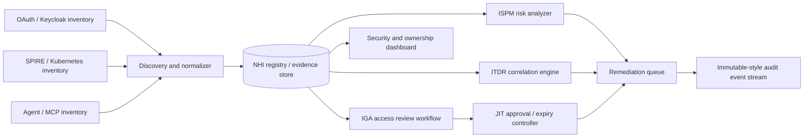

# Enterprise NHI Governance & Identity Threat Management

**Non-human identity governance · IGA · ISPM · ITDR · access review · JIT / zero standing privilege**

## Purpose and success criteria

Build an evidence-first governance and identity-threat-management control plane for synthetic service accounts, OAuth clients, Kubernetes workloads, SPIFFE identities, API keys and AI agents. Discover and normalize non-human identities (NHIs), assign accountable owners, score exposure, review access, enforce temporary privilege expiry and generate auditable detection/remediation records.

**Acceptance criteria:** every discovered NHI has an identity type and source; orphaned/overprivileged identities are flagged; access review decisions produce revocation tasks; JIT grants expire and are denied afterward; suspicious token/agent behavior generates a risk finding; remediation evidence links to the affected identity and owner.

## Logical architecture



**Trust boundaries:** TB1 source APIs to collection adapters; TB2 normalized inventory to governance database; TB3 access review approvals to entitlement-changing actions; TB4 ITDR detections to response; TB5 audit evidence to review/export. Simulated connectors must not claim to discover resources in systems they do not actually interrogate.

## Identity inventory data model

| Field | Example | Reason |
|---|---|---|
| `identity_id` | `spiffe://globalfin.local/ns/finance/sa/report-reader` | Stable identity key |
| `identity_type` | `spiffe-workload` / `oauth-client` / `ai-agent` | Identity class |
| `source_system` | `spire` / `keycloak` / `mcp` | Provenance |
| `owner_id` | `team-finance-platform` | Accountability |
| `business_unit` | `retail` | Scope/context |
| `environment` | `dev` | Risk segmentation |
| `entitlements` | `reports:read` | Effective rights |
| `credential_expires_at` | ISO 8601 timestamp | Rotation/expiry tracking |
| `last_seen_at` | ISO 8601 timestamp | Dormancy detection |
| `risk_findings` | List of evidence references | Risk analysis |
| `lifecycle_state` | `active`, `suspended`, `retired` | Governance state |

Separate source-of-truth fields from inferred attributes; preserve synchronization timestamps and provenance. The registry is not itself an identity provider or proof of an entitlement revocation.

## Core components

| Component | Purpose | Security control |
|---|---|---|
| Discovery adapters | Import synthetic or local NHI records | Read-only source credentials when possible |
| Identity normalizer | Deduplicate records, preserve provenance | Stable IDs and collision handling |
| Ownership registry | Map identities to responsible teams | Flag missing/stale owners |
| ISPM risk engine | Identify dangerous configuration/permissions | Explainable rules and evidence references |
| IGA review service | Assign reviewers, record accept/revoke | Approval integrity and decision history |
| JIT controller | Issue bounded, temporary entitlements | Approval, TTL, automatic expiry and verification |
| ITDR engine | Correlate suspicious identity activity | Document detection logic and false positives |
| Remediation worker | Execute approved changes or simulated tasks | Idempotency and rollback plans |
| Audit evidence store | Store who decided what and why | Append-only event pattern, integrity checks |
| Metrics dashboard | View posture and action progress | Avoid misleading operational claims |

## Functional flows

### F1 - Discovery and reconciliation

Import local Keycloak clients, SPIRE registration metadata, Kubernetes Service Accounts and agent registrations (or labeled synthetic fixtures). Normalize records, attach owners, identify duplicates and orphan identities, then record collection times, errors and missing source coverage. Support repeatable reconciliation and eventual consistency.

### F2 - Identity Security Posture Management (ISPM)

Flag risk scenarios such as overly broad audiences/scopes, long-lived credentials, missing owner, high privilege, unreviewed identities or access beyond business-unit scope. Use explicit rules and an explainable risk rubric rather than an opaque score. Validate with positive and negative fixtures.

### F3 - Access review and remediation

Generate a review campaign, assign accountable reviewers, and capture approve/revoke decisions with timestamps, rationales and evidence references. A revoke decision creates a tracked remediation action; successful closure requires re-reading the source system or a clearly labeled simulated verification.

### F4 - Just-in-time access and zero standing privilege

Issue narrow, time-limited privileges only after explicit approval. Enforce permission expiry at the relevant authorization point and verify post-expiry access denial. Address clock skew, failed revocation, duplicated jobs and emergency-access scenarios.

### F5 - Identity Threat Detection and Response (ITDR)

Correlate synthetic events such as DPoP replay attempts, anomalous token use, unauthorized SPIFFE identities, repeated denied tool calls, cross-business-unit export attempts and suspicious grant escalations. Produce findings containing identity, context, detection rule, time, severity, recommended response and outcome. Keep automated blocking distinct from analyst-reviewed action.

## Proposed repository structure

```text
nhi-governance-itdr/
├── README.md
├── Makefile
├── .env.example
├── compose.yaml
├── apps/
│   ├── discovery/
│   ├── identity-registry/
│   ├── risk-engine/
│   ├── access-review/
│   ├── jit-controller/
│   ├── itdr-detector/
│   └── remediation/
├── connectors/{keycloak,spire,kubernetes,agent-registry}/
├── data/synthetic/{identities,events,reviews}/
├── rules/{posture,detections,risk-model}/
├── infrastructure/{terraform,local}/
├── tests/{unit,integration,security,workflows}/
├── scripts/{bootstrap,demo,evidence}/
├── docs/{architecture,adr,threat-model,controls,runbook}/
├── evidence/
└── .github/workflows/
```

## Example governance fixtures

| Identity | Owner | Initial finding | Expected treatment |
|---|---|---|---|
| `report-reader` SPIFFE workload | Finance Platform | Allowed narrow read access | Keep, review periodically |
| `legacy-export-client` OAuth client | Unassigned | Broad export scope, missing owner | Raise orphan/privilege finding |
| `specialist-report-agent` | AI Platform | Delegated read permission | Track actor scope and expiry |
| `temporary-auditor` | Security Team | Time-bound elevated permission | Enforce JIT expiry and verify denial |

All entities above are fictional fixtures rather than claims about actual accounts.

## Test plan and success metrics

| Test | Expected result |
|---|---|
| Duplicate identity from multiple sources | One normalized record with complete provenance |
| Identity without owner | Ownership finding and review assignment |
| Excessive scope | Documented policy/risk finding |
| Review decision to revoke | Remediation ticket, then verified or simulated outcome |
| JIT grant after expiry | Request denied, expiration evidence preserved |
| Replay/anomalous access event | ITDR finding with matched rule and correlation ID |
| Failed remediation | Retriable error, no false success indicator |
| Tampered/duplicate event | Integrity or idempotency check reports failure |

Track inventory coverage, owner attribution rate, percentage of high-risk NHIs, stale credentials, review completion rate, mean time to triage, remediation verification rate and JIT expiry enforcement results. Identify denominators and make clear that lab metrics are synthetic.

## ADRs, threats and residual risk

**Initial ADRs:** discovery precedence; owner mapping; identity graph versus relational registry; posture risk scoring; review approval model; JIT authority and expiry mechanism; response automation level; event integrity and retention; simulated versus real connector support.

**Threats:** hidden service accounts, forged ownership, excessive privileges, stolen machine credentials, agent identity impersonation, audit tampering, false confidence from stale discovery, malicious approval and unsafe automatic remediation. Apply separation of duties, least-privileged connectors, immutable-style logging and human review for destructive actions.

## Delivery roadmap

1. Implement synthetic data model and read-only local source import.
2. Add ownership reconciliation, policy-driven risk findings and metrics.
3. Implement access reviews, approval evidence and remediation tracking.
4. Add JIT expiration enforcement and automated negative tests.
5. Correlate events from Projects 01–03 into ITDR findings, then publish a governance evidence walkthrough.

## References and scope

- [NIST SP 800-207 - Zero Trust Architecture](https://csrc.nist.gov/pubs/sp/800/207/final)
- [MITRE ATT&CK](https://attack.mitre.org/)
- [OAuth Security BCP - RFC 9700](https://www.rfc-editor.org/rfc/rfc9700)
- [SPIFFE](https://spiffe.io/)

## Enterprise scenario

A human analyst requests a financial report review; an orchestrator agent delegates narrowly scoped work to a specialist; a protected API and MCP/RAG tools return synthetic records; a governance system captures ownership, approvals, access decisions and security findings. The four projects are individually demonstrable and designed to compose into one reference architecture.

## Security principles

- **Default deny and least privilege:** authenticate identities and authorize every sensitive operation and resource, not merely a successful login.
- **Explicit trust boundaries:** independent checks at identity providers, workload endpoints, gateways, policy engines and audit sinks.
- **Short-lived credentials and constrained delegation:** restrict audience, actions, time, identity and resource whenever supported.
- **Evidence-driven design:** attach a repeatable positive and negative test to every claimed security control.
- **No real financial or personal data:** use synthetic fixtures and local services. Never commit tokens, private keys, kubeconfigs or credentials.
- **Portable infrastructure:** prefer reproducible local Docker/Kubernetes tooling and Terraform Community Edition; require no paid services.

## Engineering workflow (target state)

The repository layout and commands below describe the **planned implementation**; they are not claims that the components have already been built. After implementation, document validated versions and exact prerequisites in `docs/runbook.md`.

1. Install the documented runtime versions and clone the repository.
2. Copy `.env.example` to a local `.env` and populate **development-only** values; do not commit `.env`.
3. Run `make bootstrap` to provision local dependencies, then `make up` for the lab.
4. Run `make test` and `make security-test`; capture deterministic pass/fail evidence in `evidence/`.
5. Run `make demo` for the documented allowed and denied scenarios, and `make down` to clean up.

**Suggested Makefile interface:** `bootstrap`, `up`, `down`, `lint`, `test`, `security-test`, `demo`, `evidence`, `clean`. Implement these targets and avoid adding commands to the README before they actually work.

## Documentation and delivery artifacts

Each repository is expected to contain the following **eight evidence categories**: (1) architecture diagram and trust boundaries, (2) architecture decision records, (3) running source code and local infrastructure, (4) automated unit/integration/security tests, (5) threat model, (6) risk-to-control/test matrix, (7) clearly identified limitations and residual risk, and (8) reproducible demo and logs. Prefer durable Markdown artifacts under `docs/` and redacted sample outputs under `evidence/`.

## CI/CD and repository protection

The planned pipeline should run Markdown and YAML linting, Python formatting/type checks, unit and integration tests, policy tests where applicable, dependency and container scanning, secret scanning, IaC validation and a build smoke test. Pin container image versions, dependencies and CI actions. Use branch protection, pull-request review and least-privileged workflow tokens. Never upload secrets as build artifacts; redact subject identifiers and claims from audit examples.

## Integrating the four repositories

| Repository | Primary contribution |
|---|---|
| `advanced-oauth-delegation` | OAuth/OIDC identities, delegated access tokens and API-side validation |
| `cloud-native-workload-identity` | Cryptographic identities for services and mutually authenticated transport |
| `agentic-ai-security-gateway` | Agent/tool invocation enforcement and fine-grained policy decisions |
| `nhi-governance-itdr` | Ownership, identity lifecycle, risk signals, access reviews and evidence |

Integration is **optional for local standalone demonstrations**. Document API contracts, trust domains and the expected failure mode before enabling cross-project scenarios. Authentication does not imply authorization; trust bundle federation does not imply access permission; an agent's output is never a policy decision.

## Scope and limitations

This is a reference laboratory and portfolio architecture, **not** a production-certified or independently audited security product. Prototypes, custom adapters, experimental provider features and standards still under development must be labeled as such. Production deployments would additionally require resilient key management, HA, telemetry/SIEM integration, formal operational controls, privacy review, disaster recovery and organizational approval.
